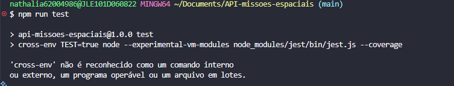
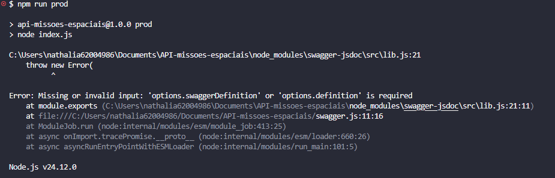
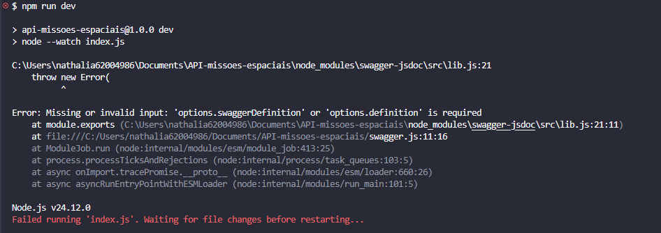

# API-missoes-espaciais

```
Nome: Nathalia Martins Correa

Curso: Informatica para internet

Turma: 2608

```
Funcionalidade da API:

- mostra as missões espaciais com nome, ano que aconteceu, que agencia fez e o status

```
Tecnologias usadas:

-Node.js

-Express

-Jest

-SuperTest

-Swagger UI

```
# INSTALAÇÃO

npm i ou npm install

```
# execusão do projeto

npm start

```
# Como executar os teste

```
npm run test

```
# Evidencias





